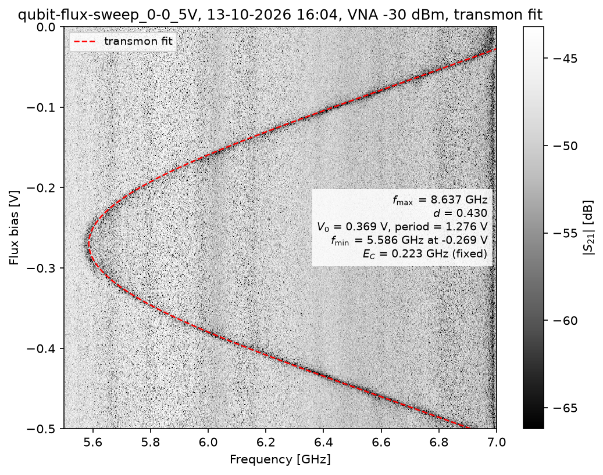
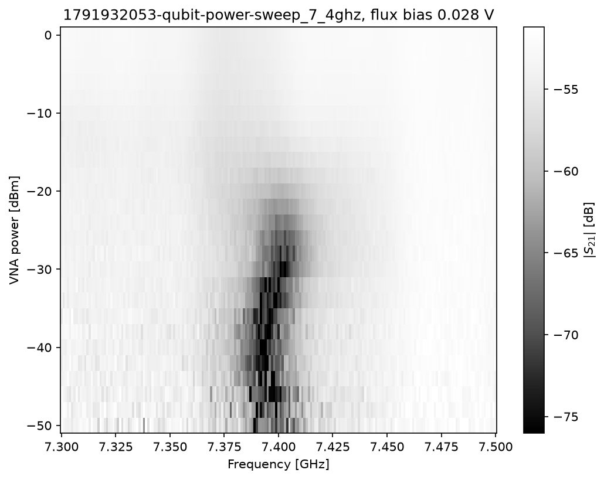
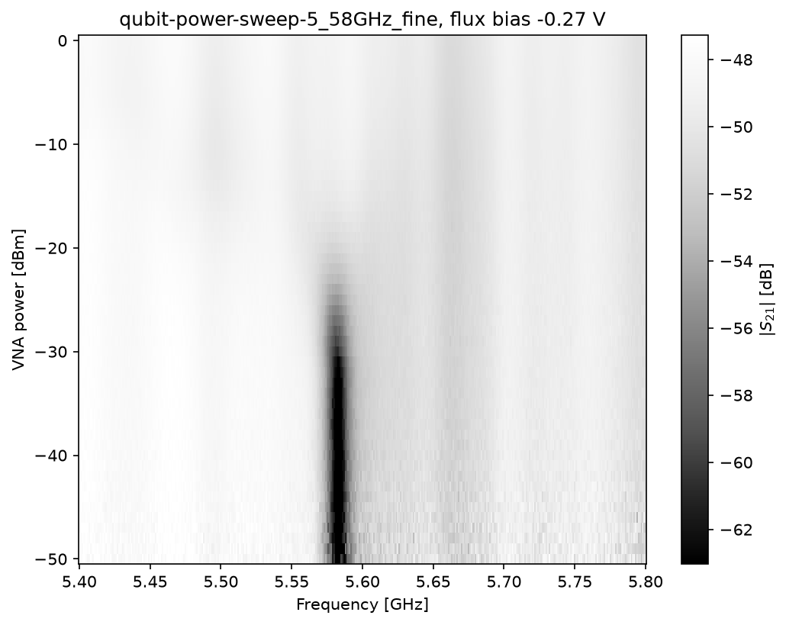
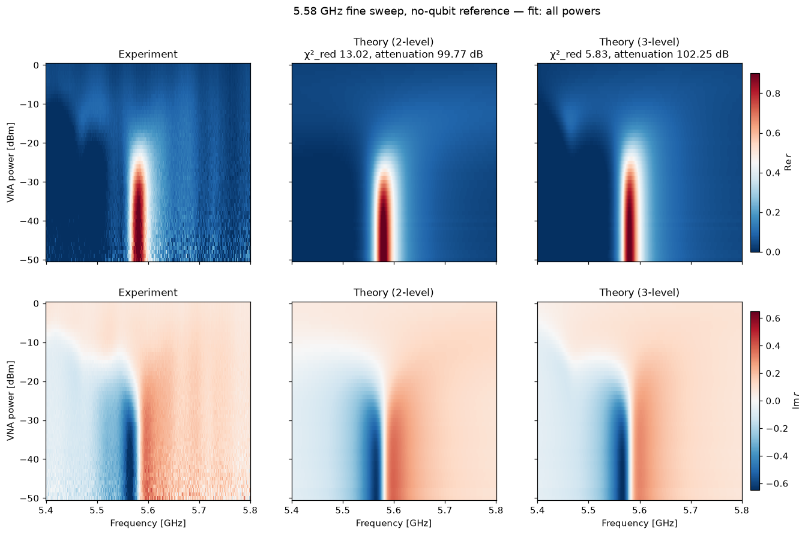
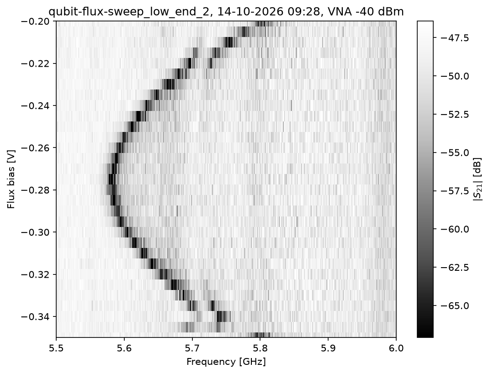

# Results by Youngdu Kim
### Summary
Attenuation: 102.25 dB (including Fano, 3-level)

## Anti-crossings in the qubit flux scan (13-10-2026)

The flux scan (`1_qubit_flux_scan`) shows two anti-crossings.

- **~5.6 GHz** (flux ≈ −0.24 to −0.25 V): probably a strongly coupled TLS. Can be source of strange qubit power scan.

- **~7.0 GHz** (flux ≈ −0.03 V): probably a package or on-chip mode.

## Qubit power scan at  5.58 GHz (13-10-2026)  

- For other frequencies, qubit frequency changed during power sweep. Need magnetic shielding?

## Qubit power calibration fitting (14-10-2026)  

- I found that anomaly is from higher level of transmon. The scan bandwidth is broad that it included 2-photon transition.
- If I use only low-power results where 2-photon transition is not shown, attenuation is similar to 3-level.

## TLS moved (14-10-2026)

- Looks like TLS at 5.6 GHz is moved to 5.7 GHz.
- Flux point is also changed a bit.

